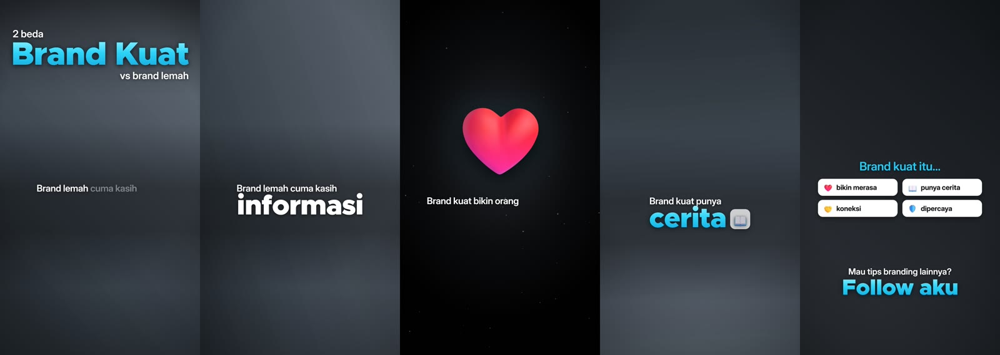

# Claude Education Skill

Kumpulan skill [Claude Code](https://claude.com/claude-code) untuk mengubah video mentah **orang bicara ke kamera**
menjadi video tips/edukasi vertikal yang rapi. Satu kali instal, dapat **dua skill**:

| Perintah | Gaya | Mesin render | Cocok untuk |
|---|---|---|---|
| **`/education-skill`** | "endorse": aksen hijau lime, kartu serif, subtitle gaya Apple 2–3 kata, judul poin pil kaca + ikon mengapung, infografis layar penuh (angka menghitung, daftar ✓/✗, chip, toggle, split, bottom-sheet) | [Remotion](https://www.remotion.dev) atau [HyperFrames](https://github.com/heygen-com/hyperframes) | video "N cara/tips/langkah", review/promosi produk |
| **`/icon-skill`** | "cyan": kata kecil putih + kata kunci besar bergradasi cyan di bawah dagu, kotak ikon emoji, cutaway layar hitam berikon raksasa, punch-in zoom, rekap pill ber-ikon, CTA "Follow aku" | mesin bawaan (Node + Chrome headless + ffmpeg) | konten perbandingan "X lemah vs X kuat", salah vs benar, dulu vs sekarang |

Kedua skill memakai SFX sintetis (bebas lisensi) dan selalu menunjukkan gambar diam untuk dicek dulu,
lalu merender penuh **setelah Anda setuju**.

**`/education-skill`** — contoh frame dari timeline demo:


**`/icon-skill`** — contoh frame dari proyek demo (latar abu-abu menggantikan video asli):



## Isi repo

```
.claude-plugin/                manifest plugin + marketplace (untuk /plugin install)
skills/
├── education-skill/           /education-skill
│   ├── SKILL.md               instruksi untuk Claude (alur kerja, aturan gaya)
│   ├── references/            style.md (panduan visual), timeline.md (format data)
│   ├── scripts/               doctor, transcribe, cut_pauses, captions, make_sfx, stills
│   └── templates/
│       ├── remotion/          proyek Remotion siap pakai (baca public/timeline.json)
│       └── hyperframes/       build_hyperframes.py → index.html untuk HyperFrames
└── icon-skill/                /icon-skill
    ├── SKILL.md
    ├── references/            contoh-edit.json (contoh proyek 6 poin "brand lemah vs kuat")
    ├── scripts/               doctor, transcribe, timeline
    └── engine/                render.mjs, stage-cyan.html, chin.py, fonts/ (OFL), sfx/
tools/build_desktop_zip.py     membuat ZIP untuk chat Claude Desktop
```

## Yang perlu dipasang

| Alat | Dipakai oleh | Cara pasang |
|---|---|---|
| [Claude Code](https://claude.com/claude-code) atau Claude Desktop | keduanya | `npm install -g @anthropic-ai/claude-code` / https://claude.com/download |
| Node.js **22+** | keduanya | https://nodejs.org · Windows `winget install OpenJS.NodeJS.LTS` · macOS `brew install node` |
| Python **3.10+** | keduanya | https://python.org · Windows `winget install Python.Python.3.13` · macOS `brew install python` |
| ffmpeg | keduanya | Windows `winget install Gyan.FFmpeg` · macOS `brew install ffmpeg` · Ubuntu `sudo apt install ffmpeg` |
| faster-whisper | keduanya (transkripsi) | `pip install faster-whisper` |
| Google Chrome | `/icon-skill` | https://www.google.com/chrome |
| opencv-python | `/icon-skill` (pelacak dagu) | `pip install opencv-python` |

Setelah skill terpasang, cek semuanya dengan mengetik di Claude Code:

```
/education-skill cek alat
/icon-skill cek alat
```

## Cara instal

Pilih **salah satu** opsi. Keduanya memasang **`/education-skill`** dan **`/icon-skill`** sekaligus.

> **Pakai aplikasi Claude Desktop (Mac/Windows)?** Ikuti
> [Tutorial instal di Claude Desktop](#tutorial-instal-di-claude-desktop-mac--windows) — langkah demi langkah.

### Opsi A — sebagai plugin (disarankan, mudah di-update)

Di terminal:

```bash
claude plugin marketplace add belajarbareng437/claude-education-skill
claude plugin install education-skill@education-skill
```

Atau dari dalam Claude Code:

```
/plugin marketplace add belajarbareng437/claude-education-skill
/plugin install education-skill@education-skill
```

Lalu mulai ulang Claude Code (atau ketik `/reload-plugins`).

> Plugin `education-skill` berisi dua skill, dipanggil dengan **`/education-skill`** dan **`/icon-skill`**.
> Bentuk lengkapnya `/education-skill:education-skill` dan `/education-skill:icon-skill` — pakai ini hanya bila
> ada skill lain bernama sama.

Memperbarui ke versi terbaru:

```bash
claude plugin marketplace update education-skill
claude plugin update education-skill@education-skill
```

Pernah memasang versi lama bernama `edukasi-video` (sebelum v2.0.0)? Hapus dulu, lalu pasang ulang seperti di atas:

```bash
claude plugin uninstall edukasi-video@edukasi-video
claude plugin marketplace remove edukasi-video
```

Menghapus:

```bash
claude plugin uninstall education-skill@education-skill
claude plugin marketplace remove education-skill
```

### Opsi B — salin folder skill secara manual

```bash
git clone https://github.com/belajarbareng437/claude-education-skill.git
```

**macOS / Linux**

```bash
mkdir -p ~/.claude/skills
cp -r claude-education-skill/skills/education-skill claude-education-skill/skills/icon-skill ~/.claude/skills/
```

**Windows (PowerShell)**

```powershell
New-Item -ItemType Directory -Force "$env:USERPROFILE\.claude\skills" | Out-Null
Copy-Item -Recurse -Force claude-education-skill\skills\education-skill, claude-education-skill\skills\icon-skill "$env:USERPROFILE\.claude\skills\"
```

Cukup butuh satu skill? Salin foldernya saja. Untuk satu proyek saja, salin ke `<proyek>/.claude/skills/`
alih-alih folder home. Mulai ulang Claude Code. Jangan pasang Opsi A dan B bersamaan, supaya tidak ada dua
skill bernama sama.

## Tutorial instal di Claude Desktop (Mac & Windows)

Aplikasi Claude Desktop punya dua tempat memakai skill. Pilih sesuai kebutuhan:

| | **Cara 1: tab Code** (disarankan) | **Cara 2: chat biasa** |
|---|---|---|
| Untuk | Edit video sungguhan sampai jadi MP4 | Merencanakan adegan, membuat `timeline.json` / `edit.json` / `index.html` |
| Akses file di komputer | Ya | Tidak — video harus diunggah ke chat |
| Bisa render video | Ya (di komputer Anda) | Biasanya tidak (sandbox terbatas); hasil dirender sendiri di komputer |
| Cara memanggil | `/education-skill`, `/icon-skill` | Minta dengan bahasa biasa, mis. "edit video ini gaya cyan" |

---

### Cara 1 — Tab **Code** di Claude Desktop

Tab Code di Claude Desktop memakai folder skill yang sama dengan Claude Code (`~/.claude/skills`),
jadi skill cukup dipasang sekali.

#### 🍎 macOS (MacBook)

1. **Pasang alat pendukung.** Buka aplikasi **Terminal** (Cmd + Spasi → ketik `Terminal`), lalu jalankan:
   ```bash
   # Homebrew (lewati jika sudah ada)
   /bin/bash -c "$(curl -fsSL https://raw.githubusercontent.com/Homebrew/install/HEAD/install.sh)"

   brew install node ffmpeg python git
   brew install --cask google-chrome        # untuk /icon-skill (lewati jika Chrome sudah ada)
   pip3 install faster-whisper opencv-python
   ```
   Jika `pip3` menolak dengan pesan *externally-managed-environment*, pakai
   `pip3 install --user --break-system-packages faster-whisper opencv-python`.
2. **Unduh skill dan salin ke folder skill Claude:**
   ```bash
   cd ~/Downloads
   git clone https://github.com/belajarbareng437/claude-education-skill.git
   mkdir -p ~/.claude/skills
   cp -r claude-education-skill/skills/education-skill claude-education-skill/skills/icon-skill ~/.claude/skills/
   ```
3. **Tutup Claude Desktop sepenuhnya** (Cmd + Q), lalu buka lagi.
4. Klik tab **Code**, pilih folder kerja (mis. folder tempat video Anda), lalu ketik:
   ```
   /education-skill cek alat
   /icon-skill cek alat
   ```
   Semua baris harus `OK`. Setelah itu coba `/education-skill demo`.

#### 🪟 Windows

1. **Pasang alat pendukung.** Klik Start → ketik `PowerShell` → buka **Windows PowerShell**, lalu jalankan
   (klik **Yes** bila muncul jendela izin Administrator):
   ```powershell
   winget install OpenJS.NodeJS.LTS
   winget install Gyan.FFmpeg
   winget install Python.Python.3.13
   winget install Git.Git
   winget install Google.Chrome
   ```
   **Tutup PowerShell, buka lagi** (agar perintah baru dikenali), lalu:
   ```powershell
   pip install faster-whisper opencv-python
   ```
2. **Unduh skill dan salin ke folder skill Claude:**
   ```powershell
   cd $env:USERPROFILE\Downloads
   git clone https://github.com/belajarbareng437/claude-education-skill.git
   New-Item -ItemType Directory -Force "$env:USERPROFILE\.claude\skills" | Out-Null
   Copy-Item -Recurse -Force claude-education-skill\skills\education-skill, claude-education-skill\skills\icon-skill "$env:USERPROFILE\.claude\skills\"
   ```
   Tanpa Git? Buka https://github.com/belajarbareng437/claude-education-skill → tombol hijau **Code** →
   **Download ZIP** → ekstrak, lalu salin folder `skills\education-skill` dan `skills\icon-skill` ke
   `C:\Users\<nama-anda>\.claude\skills\` lewat File Explorer (ketik `%USERPROFILE%\.claude\skills` di
   address bar; buat foldernya bila belum ada).
3. **Tutup Claude Desktop sepenuhnya** (klik kanan ikon Claude di system tray → **Quit**), lalu buka lagi.
4. Klik tab **Code**, pilih folder kerja, lalu ketik:
   ```
   /education-skill cek alat
   /icon-skill cek alat
   ```

> Sudah memasang Claude Code CLI? Anda juga bisa memakai **Opsi A (plugin)** di atas — hasilnya terbaca
> juga oleh tab Code di Claude Desktop. Jangan pasang plugin dan salinan manual bersamaan.

**Update ke versi terbaru (Mac & Windows):** masuk ke folder `claude-education-skill` hasil clone, jalankan
`git pull`, lalu ulangi perintah salin di langkah 2 dan buka ulang Claude Desktop.

---

### Cara 2 — Chat biasa di Claude Desktop (unggah ZIP)

Langkahnya sama di Mac dan Windows. Tiap skill diunggah sebagai ZIP sendiri.

1. **Unduh ZIP skill:** buka halaman
   [Releases](https://github.com/belajarbareng437/claude-education-skill/releases/latest) →
   unduh **`education-skill.zip`** dan/atau **`icon-skill.zip`**. **Jangan diekstrak.**
   (Atau buat sendiri dari folder clone: `python tools/build_desktop_zip.py` → folder `dist/`.)
2. Buka Claude Desktop → **Settings** (Mac: Cmd + , · Windows: Ctrl + , atau klik nama Anda di kiri bawah →
   Settings) → **Capabilities** → nyalakan **Code execution and file creation**
   (di tampilan baru bernama **Create and edit files**).
3. Buka **Customize → Skills** → klik **+** → **Create skill** → **Upload a skill** → pilih ZIP-nya.
   Ulangi untuk ZIP kedua.
4. Pastikan skill **education-skill** / **icon-skill** muncul dan sakelarnya menyala.
5. Di chat baru, unggah video (klip pendek, ≤ 1–2 menit) dan tulis misalnya:
   > Edit video ini gaya endorse, topiknya 3 cara SEO. Buatkan timeline dan index.html HyperFrames.

   > Edit video ini gaya cyan (icon-skill), 4 poin brand lemah vs brand kuat. Buatkan edit.json-nya.

   Claude akan menyusun file proyek untuk diunduh, lalu Anda merendernya di komputer (lihat
   [Menjalankan manual](#menjalankan-manual-tanpa-claude)).

**Catatan Cara 2**
- Nama skill di chat sama dengan di Claude Code. Bedanya hanya deskripsi yang lebih pendek
  (unggahan skill di aplikasi Claude membatasi deskripsi 200 karakter).
- Render `/icon-skill` butuh Chrome dan ffmpeg, yang biasanya tidak ada di sandbox chat.
- Paket Team/Enterprise: admin harus mengizinkan skill dan code execution di **Organization settings**.
- Update: hapus skill lama di **Customize → Skills**, lalu unggah ZIP versi terbaru.

### Bila skill tidak muncul

| Gejala | Solusi |
|---|---|
| `/education-skill` atau `/icon-skill` tidak ada di daftar `/` | Pastikan file ada di `~/.claude/skills/<nama-skill>/SKILL.md` (Windows: `%USERPROFILE%\.claude\skills\<nama-skill>\SKILL.md`) — bukan bertingkat dua folder — lalu tutup penuh dan buka ulang Claude Desktop. |
| `cek alat` bilang `node`/`ffmpeg`/Chrome tidak ditemukan | Tutup dan buka ulang Claude Desktop setelah memasang alat (PATH baru belum terbaca). Windows: log out/log in bila perlu. Chrome di lokasi tak biasa: set env `CHROME_PATH`. |
| `/icon-skill` gagal "chin.py gagal" | Python yang dipakai belum punya OpenCV: `pip install opencv-python`. Punya beberapa Python? Set env `PYTHON` ke yang benar. |
| Unggah ZIP gagal "Missing SKILL.md" | Unggah ZIP dari Releases apa adanya; jangan ZIP ulang seluruh repo. |
| Unggah ZIP gagal karena code execution | Nyalakan **Code execution and file creation** di Settings → Capabilities. |

## Cek bahwa skill sudah terpasang

Di Claude Code ketik `/` lalu `education` atau `icon` — `/education-skill` dan `/icon-skill` harus muncul.
Atau jalankan `/skills` untuk melihat semua skill yang aktif.

## Cara pakai

### `/education-skill` — gaya endorse

```
/education-skill <video> [remotion|hyperframes] [topik / catatan]
```

```
/education-skill D:\video\tips-seo.mov remotion topiknya 3 cara website muncul di Google
/education-skill rekaman-panjang.mp4 hyperframes video 16:9, buat infografis tiap poin
/education-skill demo          ← contoh bawaan tanpa video, cocok untuk mencoba pertama kali
/education-skill cek alat      ← cek Node, ffmpeg, Python, faster-whisper
```

Kalau mesin tidak disebut, dipakai **Remotion**.

### `/icon-skill` — gaya cyan ber-ikon

```
/icon-skill <video> [topik / catatan]
```

```
/icon-skill D:\video\brand.mov 6 poin brand lemah vs brand kuat, CTA "Follow aku"
/icon-skill revisi brand-kuat  ganti ikon poin 3 jadi 🤝 dan jadikan cutaway
/icon-skill cek alat           ← cek Node, ffmpeg, Chrome, Python, opencv-python, faster-whisper
```

Paling cocok untuk struktur **perbandingan per poin**: tiap poin punya kalimat "lemah" (kata besar putih) dan
kalimat "kuat" (kata besar cyan + ikon, sebagian jadi cutaway layar hitam).

### Atau minta dengan bahasa biasa

Claude memilih skill yang cocok sendiri, tanpa perlu `/`:

> Edit video `D:\video\tips-seo.mov` gaya endorse pakai Remotion. Topiknya 3 cara website muncul di Google.

> Edit video `D:\video\brand.mov` gaya cyan, brand lemah vs brand kuat.

### Yang terjadi setelah dipanggil

1. Transkripsi per kata (faster-whisper).
2. Claude menyusun isi: adegan di `timeline.json` (`/education-skill`) atau poin lemah/kuat di `edit.json` (`/icon-skill`).
3. Claude menunjukkan **gambar diam** + daftar "yang perlu dicek".
4. **Render penuh hanya setelah Anda bilang "oke render"/"setuju".**
5. Hasil MP4 dicek durasi, resolusi, dan suaranya, lalu dilaporkan.

### Menjalankan manual (tanpa Claude)

Dari folder hasil `git clone`.

**`/education-skill`** dengan Remotion:

```bash
S="$PWD/claude-education-skill/skills/education-skill"   # lokasi skill

# 1. Siapkan proyek Remotion
cp -r "$S/templates/remotion" my-video && cd my-video && npm install

# 2. Transkripsi + potong jeda
python -I "$S/scripts/transcribe.py" ../mentah.mp4 words.json --prompt "SEO, Google, Search Console"
python -I "$S/scripts/cut_pauses.py" ../mentah.mp4 words.json public/cut.mp4 words_cut.json

# 3. Tulis adegan di public/timeline.json (lihat references/timeline.md), set "video": "cut.mp4", lalu:
python -I "$S/scripts/captions.py" words_cut.json public/timeline.json

# 4. Preview & render
npx remotion studio                                   # pratinjau di browser
npx remotion render Endorse out/video.mp4 --codec=h264 --crf=18
```

Dengan **HyperFrames** (langkah 2–3 sama, tapi file di folder biasa, bukan `public/`):

```bash
python -I "$S/templates/hyperframes/build_hyperframes.py" my-hf/timeline.json my-hf/index.html
cd my-hf
npx hyperframes lint .
npx hyperframes preview
npx hyperframes render -o out/video.mp4
```

Melihat contoh demo tanpa video:

```bash
cd "$S/templates/remotion" && npm install && npx remotion studio
```

**`/icon-skill`**:

```bash
I="$PWD/claude-education-skill/skills/icon-skill"        # lokasi skill
mkdir -p my-cyan/work && cd my-cyan

# 1. Transkripsi -> work/<nama>.words.json
python -I "$I/scripts/transcribe.py" ../mentah.mov --out work --model small

# 2. Salin contoh lalu sunting: source, words, segments, hook, points, recap, cta
cp "$I/references/contoh-edit.json" edit.json
python -I "$I/scripts/timeline.py" .                   # peta indeks kata -> waktu

# 3. Cek gambar diam, lalu render penuh
node "$I/engine/render.mjs" . --stills 1.2,4.6,9.5,15.5
node "$I/engine/render.mjs" . --version 1               # -> out/<name>-v1.mp4
```

Windows PowerShell: ganti `S=...`/`I=...` dengan `$I = "$PWD\claude-education-skill\skills\icon-skill"` dan pakai
`"$I\engine\render.mjs"`.

## Font

**`/education-skill`**
- **Inter** dan **Bodoni Moda** (Google Fonts) dimuat otomatis.
- Gaya aslinya memakai **Coolvetica** untuk subtitle. Font ini berlisensi (Typodermic), jadi **tidak disertakan**.
  Kalau Anda punya lisensinya, taruh file-nya di `public/fonts/Coolvetica.otf` (Remotion) atau di samping
  `index.html` (HyperFrames), lalu tambahkan ke `timeline.json`:
  ```json
  "subtitleFont": "fonts/Coolvetica.otf"
  ```
  Tanpa itu subtitle memakai Inter Bold.

**`/icon-skill`**
- **Inter** dan **Metropolis Black** disertakan di `engine/fonts/` (keduanya SIL Open Font License).
- Ikon memakai emoji berwarna bawaan sistem: Segoe UI Emoji (Windows), Apple Color Emoji (macOS),
  Noto Color Emoji (Linux: `sudo apt install fonts-noto-color-emoji`).

## Lisensi

- Kode di repo ini: [MIT](LICENSE).
- SFX dibuat sintetis (`make_sfx.py`, `gen-sfx.mjs`), bebas dipakai.
- Font di `skills/icon-skill/engine/fonts/`: SIL Open Font License 1.1 (lihat `LICENSE.md` di folder itu).
- **Remotion** punya lisensi sendiri: gratis untuk perorangan dan perusahaan kecil, perusahaan besar perlu
  lisensi berbayar — lihat https://www.remotion.dev/license.
- **HyperFrames** berlisensi Apache 2.0.
