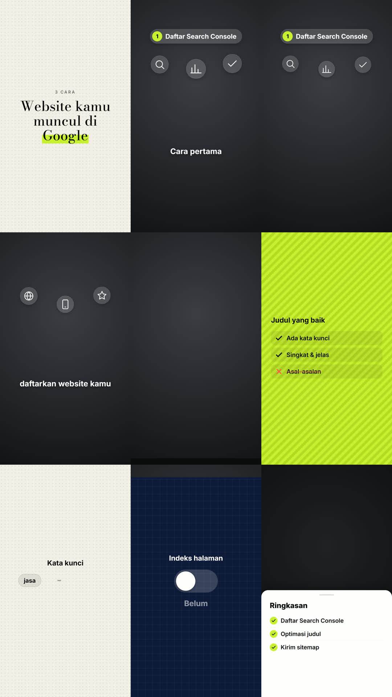

# Claude Education Skill

Skill [Claude Code](https://claude.com/claude-code) untuk mengubah video mentah **orang bicara ke kamera**
menjadi video tips/edukasi vertikal yang rapi dan bergaya "endorse". Hasilnya bisa dirender dengan
**[Remotion](https://www.remotion.dev)** (React) atau **[HyperFrames](https://github.com/heygen-com/hyperframes)** (HTML + GSAP).

Ciri gayanya: aksen hijau lime, kartu pembuka/penutup serif di kertas bertitik, subtitle gaya Apple 2–3 kata
(tiap kata muncul sendiri, dari buram ke tajam), judul poin di pil kaca dengan ikon mengapung, infografis
layar penuh (angka menghitung, daftar ✓/✗, chip, toggle, split, bottom-sheet), framing lebar dan close-up
bergantian, plus SFX swoosh/pop/tik tanpa musik.



## Isi repo

```
.claude-plugin/                manifest plugin + marketplace (untuk /plugin install)
skills/claude-education-skill/
├── SKILL.md                   instruksi untuk Claude (alur kerja, aturan gaya)
├── references/
│   ├── style.md               panduan visual: warna, huruf, ukuran, animasi, ritme
│   └── timeline.md            format timeline.json (satu data untuk dua mesin)
├── scripts/                   Python: doctor, transcribe, cut_pauses, captions, make_sfx, stills
└── templates/
    ├── remotion/              proyek Remotion siap pakai (baca public/timeline.json)
    └── hyperframes/           build_hyperframes.py → index.html untuk HyperFrames
```

## Yang perlu dipasang

| Alat | Untuk apa | Cara pasang |
|---|---|---|
| [Claude Code](https://claude.com/claude-code) | menjalankan skill | `npm install -g @anthropic-ai/claude-code` |
| Node.js **22+** | Remotion / HyperFrames | https://nodejs.org atau `winget install OpenJS.NodeJS.LTS` |
| Python **3.10+** | script persiapan | https://python.org atau `winget install Python.Python.3.13` |
| ffmpeg | potong jeda, audio, cek hasil | Windows `winget install Gyan.FFmpeg` · macOS `brew install ffmpeg` · Ubuntu `sudo apt install ffmpeg` |
| faster-whisper | transkripsi per kata | `pip install faster-whisper` |

Setelah skill terpasang, cek semuanya dengan mengetik di Claude Code:

```
/claude-education-skill cek alat
```

(atau dari folder hasil clone: `python skills/claude-education-skill/scripts/doctor.py`)

## Cara instal

Pilih **salah satu** opsi. Keduanya membuat skill bisa dipanggil dengan **`/claude-education-skill`**.

### Opsi A — sebagai plugin (disarankan, mudah di-update)

Di terminal:

```bash
claude plugin marketplace add belajarbareng437/claude-education-skill
claude plugin install edukasi-video@edukasi-video
```

Atau dari dalam Claude Code:

```
/plugin marketplace add belajarbareng437/claude-education-skill
/plugin install edukasi-video@edukasi-video
```

Lalu mulai ulang Claude Code (atau ketik `/reload-plugins`).

> Kenapa nama pluginnya `edukasi-video`, bukan `claude-education-skill`? Claude Code melarang nama **plugin**
> yang diawali `claude-` (dicadangkan untuk Anthropic). Nama **skill**-nya tetap `claude-education-skill`,
> jadi perintahnya tetap `/claude-education-skill`. Bentuk lengkapnya `/edukasi-video:claude-education-skill`
> — pakai bentuk ini kalau ada skill lain bernama sama.

Memperbarui ke versi terbaru:

```bash
claude plugin marketplace update edukasi-video
claude plugin update edukasi-video@edukasi-video
```

Menghapus:

```bash
claude plugin uninstall edukasi-video@edukasi-video
claude plugin marketplace remove edukasi-video
```

### Opsi B — salin folder skill secara manual

```bash
git clone https://github.com/belajarbareng437/claude-education-skill.git
```

**macOS / Linux**

```bash
mkdir -p ~/.claude/skills
cp -r claude-education-skill/skills/claude-education-skill ~/.claude/skills/
```

**Windows (PowerShell)**

```powershell
New-Item -ItemType Directory -Force "$env:USERPROFILE\.claude\skills" | Out-Null
Copy-Item -Recurse claude-education-skill\skills\claude-education-skill "$env:USERPROFILE\.claude\skills\"
```

Untuk satu proyek saja, salin ke `<proyek>/.claude/skills/` alih-alih folder home.
Mulai ulang Claude Code. Jangan pasang Opsi A dan B bersamaan, supaya tidak ada dua skill bernama sama.

### Cek bahwa skill sudah terpasang

Di Claude Code ketik `/` lalu `claude-edu` — `/claude-education-skill` harus muncul di daftar.
Atau jalankan `/skills` untuk melihat semua skill yang aktif.

## Cara pakai

### Memanggil dengan perintah

```
/claude-education-skill <video> [remotion|hyperframes] [topik / catatan]
```

Contoh:

```
/claude-education-skill D:\video\tips-seo.mov remotion topiknya 3 cara website muncul di Google
```

```
/claude-education-skill rekaman-panjang.mp4 hyperframes video 16:9, buat infografis tiap poin
```

```
/claude-education-skill demo
```
(menampilkan contoh bawaan tanpa video — cocok untuk mencoba pertama kali)

```
/claude-education-skill cek alat
```
(mengecek Node, ffmpeg, Python, faster-whisper)

Kalau mesin tidak disebut, dipakai **Remotion**.

### Atau minta dengan bahasa biasa

Claude juga memakai skill ini sendiri bila permintaannya cocok, tanpa perlu `/`:

> Edit video `D:\video\tips-seo.mov` gaya endorse pakai Remotion. Topiknya 3 cara website muncul di Google.

### Yang terjadi setelah dipanggil

1. Transkripsi per kata → potong jeda otomatis.
2. Claude menyusun adegan di `timeline.json` (kartu pembuka, judul poin, infografis, kartu penutup).
3. Claude menunjukkan **storyboard** (gambar diam) + daftar "yang perlu dicek".
4. **Render penuh hanya setelah Anda bilang "oke render"/"setuju".**
5. Hasil MP4 dicek durasi dan frame-nya, lalu dilaporkan.

### Menjalankan manual (tanpa Claude)

Dari folder hasil `git clone`:

```bash
S="$PWD/claude-education-skill/skills/claude-education-skill"   # lokasi skill

# 1. Siapkan proyek Remotion
cp -r "$S/templates/remotion" my-video && cd my-video && npm install

# 2. Transkripsi + potong jeda
python -I "$S/scripts/transcribe.py" ../mentah.mp4 words.json --prompt "SEO, Google, Search Console"
python -I "$S/scripts/cut_pauses.py" ../mentah.mp4 words.json public/cut.mp4 words_cut.json

# 3. Tulis adegan di public/timeline.json (lihat references/timeline.md), set "video": "cut.mp4", lalu:
python -I "$S/scripts/captions.py" words_cut.json public/timeline.json

# 4. Preview & render
npx remotion studio                                   # pratinjau di browser
npx remotion render Endorse out/video.mp4 --codec=h264 --crf=18
```

Dengan **HyperFrames** (langkah 2–3 sama, tapi file di folder biasa, bukan `public/`):

```bash
python -I "$S/templates/hyperframes/build_hyperframes.py" my-hf/timeline.json my-hf/index.html
cd my-hf
npx hyperframes lint .
npx hyperframes preview
npx hyperframes render -o out/video.mp4
```

Melihat contoh demo tanpa video:

```bash
cd "$S/templates/remotion" && npm install && npx remotion studio
```

## Font

- **Inter** dan **Bodoni Moda** (Google Fonts) dimuat otomatis.
- Gaya aslinya memakai **Coolvetica** untuk subtitle. Font ini berlisensi (Typodermic), jadi **tidak disertakan**.
  Kalau Anda punya lisensinya, taruh file-nya di `public/fonts/Coolvetica.otf` (Remotion) atau di samping
  `index.html` (HyperFrames), lalu tambahkan ke `timeline.json`:
  ```json
  "subtitleFont": "fonts/Coolvetica.otf"
  ```
  Tanpa itu subtitle memakai Inter Bold.

## Lisensi

- Kode di repo ini: [MIT](LICENSE).
- SFX dibuat sintetis oleh `make_sfx.py`, bebas dipakai.
- **Remotion** punya lisensi sendiri: gratis untuk perorangan dan perusahaan kecil, perusahaan besar perlu
  lisensi berbayar — lihat https://www.remotion.dev/license.
- **HyperFrames** berlisensi Apache 2.0.
